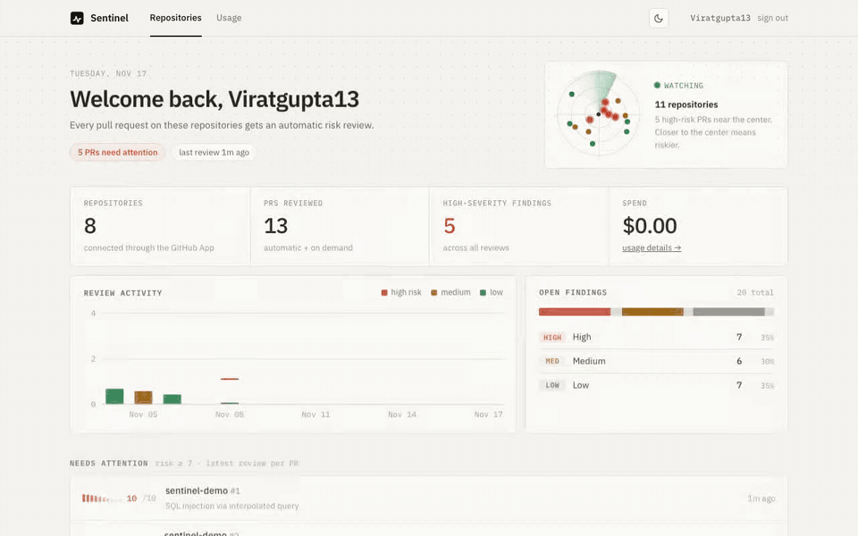
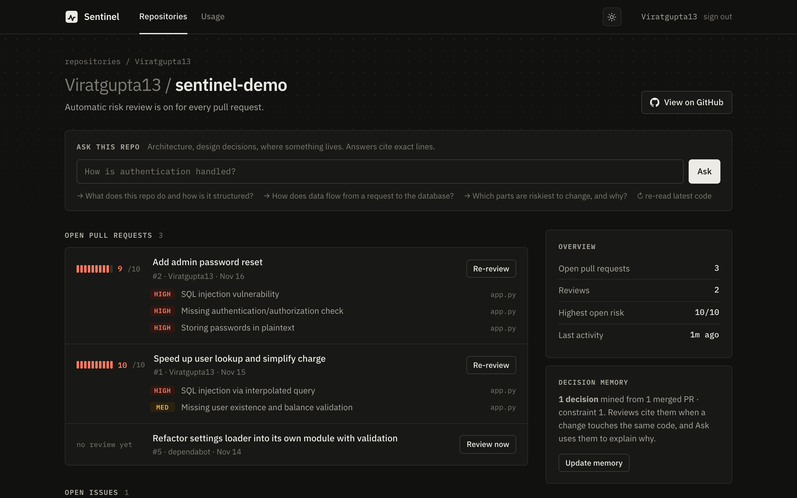
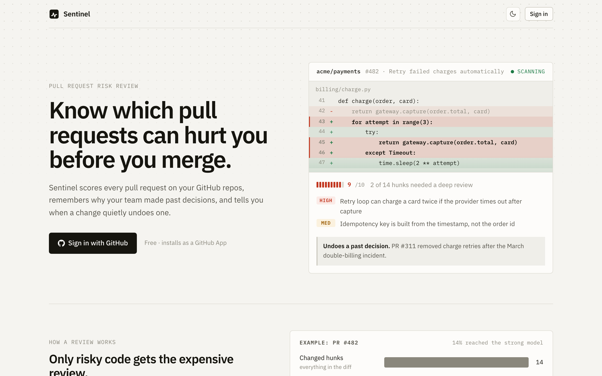
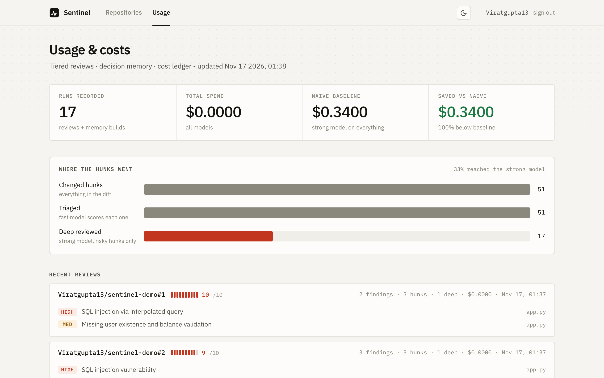
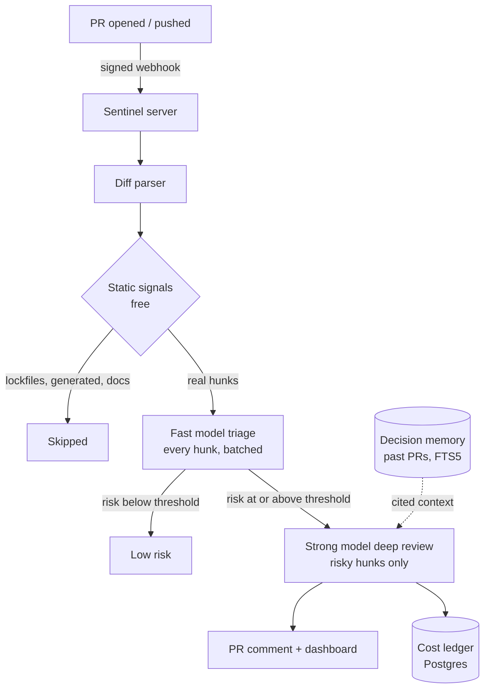
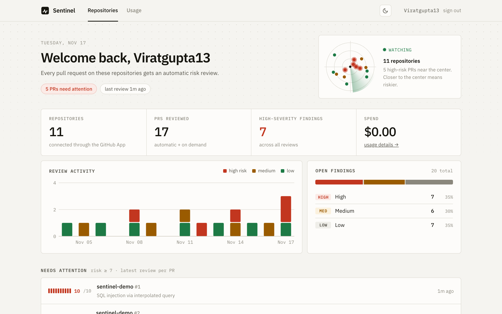
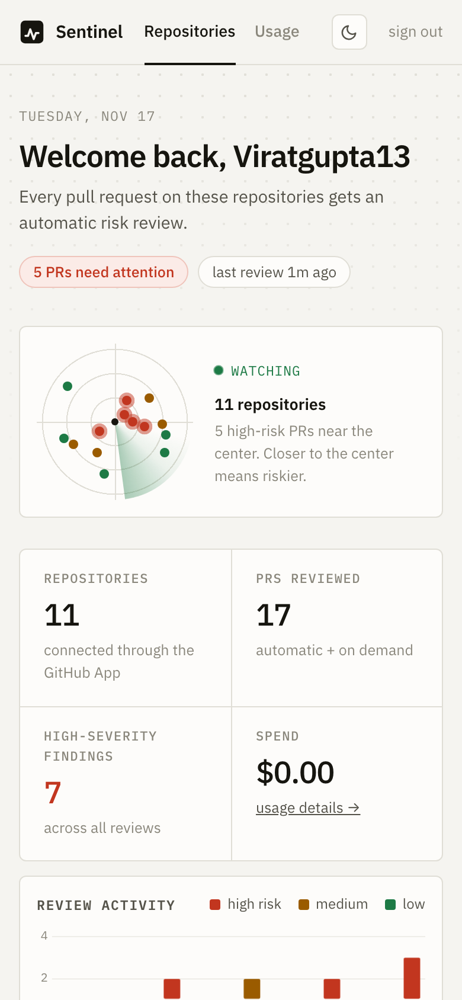
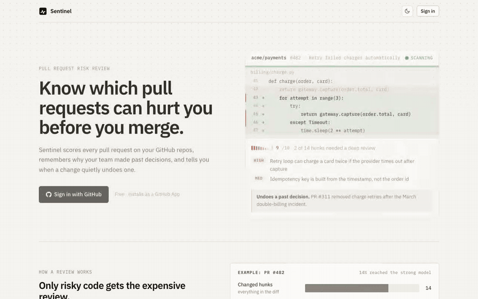

# Sentinel

**Know which pull requests can hurt you before you merge.**

Sentinel is a GitHub App that risk-scores every pull request, remembers why your
team made past decisions, and flags changes that quietly undo them. It sends only
the risky parts of a diff to a strong model, so reviews stay fast and cheap.

[**Live demo → sentinel-us50.onrender.com**](https://sentinel-us50.onrender.com) ·
[Deploy your own](docs/HOSTING.md) ·




## What it does

| | |
|---|---|
| **Risk-scored reviews** - every PR opened on an installed repo is reviewed automatically. The result lands as one PR comment (updated on each push) and on the dashboard, with a 0-10 risk score and findings tied to files. |  |
| **Ask any repo** - "How does auth work?" "Why is this built this way?" Answers cite numbered sources that open the exact file and line range on GitHub, and answer in the asker's language. |  |
| **Decision memory** - mines merged PRs for the team's decisions and their reasons. A change that re-introduces something removed on purpose is escalated and the source PR is cited. |  |

## How it works



The expensive model never sees the whole diff: a free static pass drops noise,
a cheap model scores each remaining hunk, and only hunks above the risk threshold
(plus a static floor for auth, payments, DB and security code) get a deep review.

## Results so far (measured)

Backtest on **home-assistant/core**, using the free Groq models: 25 merged PRs that
were later reverted (the "bad" ones) and 10-15 that were not.

| pipeline | reverted PRs flagged (recall) | clean PRs flagged (noise) | tokens / PR |
|---|---|---|---|
| static rules only | 0% | 0% | 0 |
| + fast-model triage | 24% | 50% | 3,351 |
| + strong-model deep review | **48%** | 70% | 5,814 |

- Deep review **doubles recall** over triage alone (24% → 48%). Labels are
  conservative (only explicit reverts count), so recall is a lower bound.
- Noise is still high on free models; the headline run with Claude models and the
  memory ablation is next. Full table: [evals/results](evals/results/home-assistant__core.groq.md).
- Live: on the demo repo, Sentinel rated a PR that builds SQL from user input
  **10/10** and one that stores plaintext passwords **9/10**.
- 85 automated tests, run on SQLite and on a real Postgres.

## Built with

Python 3.11+ · FastAPI · GitHub App + OAuth (per-installation tokens) · Postgres
(Neon) / SQLite · SQLite FTS5 retrieval · Anthropic Claude or any OpenAI-compatible
provider (Groq free tier in the live demo) · server-rendered HTML/SVG, no frontend
framework · Render + GitHub Actions.

<details><summary>More screenshots</summary>

| Home (light) | Mobile |
|---|---|
|  |  |



</details>

Screenshots and GIFs use a seeded demo instance; the live site shows real data.

## Quickstart

```bash
python -m venv .venv && source .venv/bin/activate
pip install -e ".[dev]"

cp .env.example .env         # add ANTHROPIC_API_KEY
sentinel review https://github.com/<owner>/<repo>/pull/<n>
```

Useful flags:

```bash
sentinel review <pr-url> --out report.md --json report.json
sentinel review <pr-url> --threshold 6 --max-hunks 5   # stricter + cheaper
sentinel review --diff changes.diff                    # local diff, no GitHub
sentinel review --diff changes.diff --static-only      # zero LLM calls (free dry run)
```

Exit codes: `0` clean, `1` pipeline error, `2` high-severity findings (CI-friendly).

## Decision memory (Phase 2)

Mine a repo's merged-PR history once; every later `sentinel review` of that repo
automatically retrieves relevant past decisions (with PR citations) into the
deep-review prompt:

```bash
sentinel memory build owner/name --limit 200   # Sonnet extracts durable decisions
sentinel memory stats owner/name
sentinel memory search owner/name "payment retry timeout"
```

Memories live in `~/.sentinel/memory/<owner>__<name>.db` (SQLite + FTS5; BM25
keyword + path-overlap retrieval - deterministic and dependency-free). Most PRs
yield zero decisions by design: the memory only works if it stays high-precision.
A hunk that re-introduces something the team removed on purpose (incident/constraint)
is escalated to high severity with the source PR cited.

## Configuration

Env vars (prefix `SENTINEL_`, see `.env.example`): `TRIAGE_MODEL`, `REVIEW_MODEL`,
`RISK_THRESHOLD` (default 4), `MAX_REVIEW_HUNKS` (default 12), `TRIAGE_BATCH_SIZE`.

Models: triage `claude-haiku-5-5`, deep review `claude-opus-5-5`
(decision-memory extraction, Phase 2: `claude-sonnet-5-5`).

### Free-tier providers

`SENTINEL_PROVIDER=openai` routes every LLM call to any OpenAI-compatible
endpoint (Groq, Google AI Studio, OpenRouter - all have free tiers); see the
commented blocks in `.env.example`. Structured output is enforced by prompt +
Pydantic validation on this path; Anthropic-only features (prompt caching,
effort control, native JSON-schema constraint) are skipped, and unknown models
show $0 in the cost ledger.

## Webhook server (Phase 5)

The vision end-to-end: a PR is opened → Sentinel reviews it automatically →
the findings land as a comment on the PR, and on the live dashboard.

```bash
pip install -e ".[server]"
sentinel serve --port 8000       # POST /webhook/github · GET /dashboard · GET /healthz
```

Point a GitHub webhook at `/webhook/github` (content type `application/json`,
events: *Pull requests*) and set `SENTINEL_WEBHOOK_SECRET` to the webhook's
secret - unsigned payloads are only accepted when no secret is configured
(local testing). On `opened` / `synchronize` / `reopened` / `ready_for_review`
(drafts skipped) the server reviews the PR in the background and upserts a
single marker-tagged comment per PR (updated on each push, no comment spam;
needs a `GITHUB_TOKEN` with write access; disable with
`SENTINEL_POST_COMMENTS=false`). Each finding is also posted inline on its
line for 👍/👎 rating (`SENTINEL_INLINE_COMMENTS=false` turns that off).

`GET /dashboard` serves the same unified dashboard as `sentinel costs --html`:
recent reviews (risk + findings), decision-memory stats per repo, tokens by
model, and total spend vs the naive baseline.

## Hosted hub (Phase 6)

The same server becomes a multi-tenant product when GitHub App + OAuth env
vars are set (see [docs/HOSTING.md](docs/HOSTING.md) for the click-by-click
deploy guide - Render free tier works):

- **Sign in with GitHub** (OAuth, zero scopes) with signed session cookies
- users **install the Sentinel GitHub App** on any repos, public or private;
  `installation` webhooks keep the tenant store in sync
- every review runs with that installation's **short-lived token** - no PATs,
  and comments post as the app
- `/dashboard` is per-user (only repos your installations cover) and
  **live-updates** as new PRs are reviewed
- set `SENTINEL_DATABASE_URL` (free Neon Postgres) and review history +
  users live in Postgres, surviving redeploys on ephemeral-disk hosts;
  unset, everything stays in local SQLite

## Development

```bash
pytest                 # unit + wiring tests (no API key needed)
SENTINEL_TEST_DATABASE_URL=postgresql://localhost/scratch pytest tests/test_db.py  # + Postgres
ruff check src tests
docker build -t sentinel . && docker run sentinel version
```

## Roadmap

- [x] **Phase 1 - tiered review pipeline**: diff parsing, static signals,
  Haiku triage, Opus deep review, cost ledger, CLI, CI, Docker
- [x] **Phase 2 - decision memory**: Sonnet mines merged PRs + review comments
  into per-repo SQLite/FTS5 memory; risky hunks retrieve past decisions with
  PR citations into the review prompt
- [x] **Phase 3 - cost history + dashboard**: every run recorded to
  `~/.sentinel/costs.db`; `sentinel costs [--html dashboard.html]` aggregates
  spend, tokens by model, and savings vs the naive baseline (cache tuning +
  Batch API backfills pending an Anthropic-key run)
- [x] **Phase 4 - eval harness**: `sentinel eval collect/run/grade` - revert-labeled
  datasets, resumable ablation backtests (static/triage/full/memory), recall +
  noise + cost table (see `evals/README.md`); headline numbers pending a
  strong-model run
- [x] **Phase 5 - webhook server**: `sentinel serve` - GitHub `pull_request`
  webhook (HMAC-verified) triggers an automatic review and posts/updates one
  review comment per PR; live unified dashboard at `/dashboard`
- [x] **Phase 6 - hosted hub**: GitHub App + "Sign in with GitHub" - install
  on any repo, reviews run on per-installation tokens, per-user live
  dashboard; one-click Render deploy (`render.yaml`, `docs/HOSTING.md`)
- [x] **Phase 7a - repo-centric UI**: home is your repo grid; each repo page
  shows live open PRs (risk-badged once reviewed), open issues, review
  history and decision-memory stats; costs move to `/overview`
- [x] **Phase 7b - ask the repo**: chat on every repo page. The repo is
  snapshotted in one tarball request, chunked into a per-repo SQLite FTS5
  index (porter stemming, path-word boosting, tests ranked below
  implementation), merged with decision memory, and answered with numbered
  citations that link to exact GitHub line ranges / source PRs. Answers in
  the asker's language (Hinglish stays Hinglish)
- [x] **Phase 7c - durable storage**: optional Postgres backend
  (`SENTINEL_DATABASE_URL`) for review history and the tenant store; one
  shared autocommit connection with reconnect-on-drop, the same store code
  on both backends, tested against SQLite and a real Postgres
- [x] **Phase 7d - on-demand actions**: "Review now" on any open PR,
  "Build decision memory" from the repo page (mirrored to Postgres so it
  survives redeploys), live repo-page refresh, keep-alive ping workflow
- [x] **Phase 7e - product UI**: IBM Plex instrument-style design, dark/light
  toggle, home radar of reviewed PRs, review-activity and open-findings
  charts, hunk funnel, code-scan landing page (all server-rendered SVG/CSS,
  reduced-motion aware)
- [x] **Phase 8 - inline comments + feedback**: each finding is also posted
  as a review comment on the exact line (the deep-review model gets
  line-numbered hunks; off-diff lines fall back to the hunk's first added
  line). Re-reviews never repeat a finding (stable per-finding markers), and
  the team's 👍/👎 reactions are synced back into a feedback table shown on
  the repo page and home ("% of rated findings useful")
